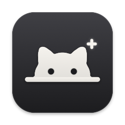

<p align="center">
  
</p>

<h1 align="center">ThatPet Ollama Extension</h1>

<p align="center">
  Your <a href="https://thatpet.app">ThatPet</a> reacts to <b>Ollama Desktop</b>.<br>
  It thinks while the model thinks, browses while it searches the web<br>
  and celebrates when the reply is ready.
</p>

<p align="center">
  <a href="https://github.com/ImP4ncake/thatpet-ollama-extension/releases/latest/download/ThatPet-Ollama-Extension.dmg"><b>⬇︎ Download for macOS</b></a>
  <br>
  <sub>macOS 13 or later · Apple Silicon and Intel · free and open source</sub>
</p>

---

## What your pet does

| In Ollama | Your pet |
| :-- | :-- |
| You send a message | 🤔 Thinks |
| The model searches the web | 🌐 Browses the web |
| The reply is ready | 🎉 Celebrates |
| Something goes wrong | ⚠️ Shows an error |
| You stop the reply | 💤 Goes back to idle |

## Install

1. Download **[ThatPet-Ollama-Extension.dmg](https://github.com/ImP4ncake/thatpet-ollama-extension/releases/latest/download/ThatPet-Ollama-Extension.dmg)** and open it.
2. Drag the app into **Applications**.
3. Open it from Applications.

The first time, macOS may block it because the app isn't notarized by Apple. Go to
**System Settings → Privacy & Security** and click **Open Anyway**. You only do this once.

The extension's icon appears next to ThatPet's in the menu bar, and it opens by itself at
every login. You need [ThatPet](https://thatpet.app) 0.4 or later and
[Ollama Desktop](https://ollama.com/download).

## Features

- **Menu bar switch.** Turn the extension on or off, and see what Ollama is doing right now.
- **Notifications.** You get a notification when a long reply is ready while Ollama is in the background.
- **Self-check.** After ThatPet or Ollama updates, it checks that everything still works.
- **Automatic updates.** It installs new versions from this repository, and only ones signed by the author.

## Privacy

The extension never reads, stores or sends your conversations. From Ollama it reads only *when*
messages happen, from local files. Its only network access is the update check on GitHub.

<details>
<summary><b>How it works</b></summary>
<br>

- It watches Ollama Desktop's local database (read-only) and its log for the start and end of each reply.
- It sends the matching events to ThatPet through ThatPet's own command-line helper.
- ThatPet 0.4+ reacts only to agents linked in its menu. ThatPet has no "Ollama" agent, so the
  extension uses ThatPet's own `connect hermes` command and reports as the Hermes agent. That
  command adds a small, inert plugin to `~/.hermes/plugins/thatpet`; Hermes doesn't need to be
  installed. If the link is ever lost, the menu shows **Reconnect to ThatPet**.
- Nothing inside ThatPet or Ollama is modified.

</details>

<details>
<summary><b>Uninstall</b></summary>
<br>

1. Menu bar icon → **Quit Extension**.
2. Drag the app from Applications to the Trash.
3. Optional: delete `~/Library/Application Support/ThatPet Ollama Extension`, and remove the ThatPet link with
   `/Applications/ThatPet.app/Contents/MacOS/ThatPet disconnect hermes`.

</details>

<details>
<summary><b>Development</b></summary>
<br>

```sh
scripts/build.sh                  # build/ThatPet Ollama Extension.app (Apple Silicon + Intel)
scripts/make_dmg.sh               # build/ThatPet-Ollama-Extension.dmg, the installer
python3 tests/simulate.py "build/ThatPet Ollama Extension.app/Contents/MacOS/ThatPetOllamaExtension"
python3 tests/update_test.py      # self-update: signed, unsigned, same version, other app
scripts/release.sh 1.2.0 "What changed"
```

- `tests/simulate.py` plays real situations against a fake Ollama and a fake ThatPet. Expect `RESULT: ALL OK`.
- `scripts/release.sh` sets the version, builds the app and runs the simulation (it stops if the simulation fails).
  Then it zips and signs the app, makes the installer, and publishes the GitHub release.
- Releases are signed with an Ed25519 key in `~/.config/thatpet-ollama-extension/`. Create the key once with
  `swift scripts/signing.swift keygen` and **back it up**: installed apps only accept updates signed with it.
- `swift scripts/artwork.swift icon` redraws the app icon. The menu bar icon reads ThatPet's and Ollama's
  icons from the installed apps at runtime; they are never shipped.

</details>

---

<p align="center">
  <sub>Unofficial · not affiliated with ThatPet or Ollama · <a href="LICENSE">MIT</a> © 2026 ImP4ncake</sub>
</p>
